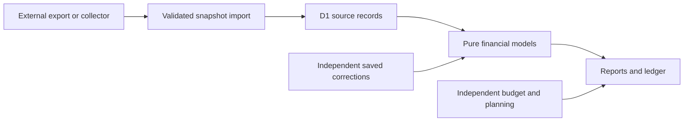

# Architecture

Neonworth is a single-user snapshot application. A separate, user-controlled collector or export tool produces data; the app validates, stores and interprets it. It has no bank connector capability.

## Runtime and authentication

React routes use Vinext, Vite and Cloudflare Workers. The default standalone profile verifies Cloudflare Access JWTs before the application handler for UI, API and MCP requests. The configured issuer, audience and single owner must match; configured failures do not fall back to another profile or anonymous access. A tightly scoped development exception requires an explicit local flag and an HTTP loopback request. Production builds disable that flag.

The separate [Sites profile](../profiles/sites/README.md) uses the supported owner-private Sites Dispatch authentication boundary. Dispatch validates browser/MCP access and consumes the Site-scoped shared-updater bearer; a valid service call need not include a visitor identity. This entry point is supported only behind confirmed private Sites access, never as a raw public Worker. Profile selection is explicit at build time. Both entries strip authentication material and discard source capabilities before application handling.

Only storage bindings and lifecycle helpers reach the application handler. Provider credentials and connector capabilities are not forwarded. Write endpoints also enforce same-origin behavior. The MCP endpoint is protected by its profile's owner boundary; external callers need the corresponding supported authentication. The workflow package can configure a requested native Sites-linked automation after verifying unattended access; it contains no scheduler service or background bank connection of its own.

## GPT Finance workflow boundary

The user's GPT Finance connection is already authorized. The collecting agent discovers actual source tools and schemas, follows all pagination and independent inflow checks, then uses the deterministic [Finance harness](../integrations/gpt-finance/README.md). Its default path prepares/verifies structured private artifacts while the host performs native calls; its injectable runner is an optional library, not a new credential-bearing service.

First import uses a strict `initialOnly:true` empty-destination guard and atomic source revision check. Ongoing refreshes retain the existing owned-run protocol, source evidence and independent corrections. Successful writes require persisted source, counts, run and month/YTD/year summary readback. A lost response triggers verification, not automatic replay. The prompts/skill/plugin route installation, refresh, upgrade and recovery without changing these domain rules.

## Data ownership

- `lib/finance.ts`, `lib/periods.ts` and report modules interpret the source snapshot.
- `lib/classification.ts`, movement and review modules produce evidence-backed interpretations without rewriting source records.
- Transaction corrections, review preferences, retirement annotations, budgets and planning are independent stored records.
- Whole-record comparisons and atomic writes prevent a stale editor from silently replacing newer data.
- Refreshes stage a complete bounded source bundle, validate it, merge retained history and read back the committed outcome. Failed refreshes preserve the last good snapshot.

Imported source amounts follow the documented sign convention. Pending transactions, unknown purposes, partial source coverage and missing equity prices are not silently converted into certainty. Transfers and investment sales are separate from consumption and new income. Personal merchant exceptions belong in saved corrections, not shared code.

## Limits and growth

The current dataset format remains a bounded full snapshot: at most 50,000 bank transactions and 7,500,000 UTF-8 bytes, with 8,000,000-byte request bounds and per-record storage limits. D1 chunking supports atomic storage but does not make browser reads or report derivation paginated across the database. A large JSON export can exceed the single-request restore envelope when independent records are included.

Before increasing limits, measure payload size, Worker memory/CPU and browser interaction time. A future partitioned model needs revision-consistent queries, bounded restore batches and parity tests, not only more SQL indexes.

## Presentation

The [design principles](NEON_DESIGN.md) distinguish artistic expression from financial communication. Neonworth is a personal neon workspace; atmosphere and visual character matter alongside utility. Decorative brand lettering may sit barely visible in deep shadow or behind light and occlusion. A focused violet/pink composition is valid without using every palette color. Financial figures, controls and status meanings retain readable, stable treatment.

Financial values and chart geometry are static. Binary rain is isolated from report layout and pauses for quiet/reduced-motion preferences, hidden tabs and other supported visibility conditions. CSS color roles distinguish financial data and status from decoration. Amount hiding is a display control; it is not anonymization or encryption.

The optional launch reveal is a separate layout sibling, lazy-loaded after its once-per-session and motion-policy checks. Its dominant overhead lamp, shadowed title and extended fade into the workspace use a generous finite sequence; ordinary control-transition budgets do not govern this opening artwork. Motion's React mini API animates only that scene; native button behavior handles skipping it. Loading and rendering financial records proceed independently, with no animation of the workspace shell or dialog ancestors. Its implementation and pending desktop checks are documented in [the launch guide](LAUNCH_INTRO.md). Artwork remains original; dependency licenses and the exclusion of paid component source remain unchanged.

## Testing

All public tests and examples use synthetic records. Domain regressions cover accounting, scope, corrections and source evidence. Storage tests cover concurrency, corruption, recovery and independent-record preservation. Authentication tests cover denial cases. Browser keyboard, privacy and responsive checks remain separate evidence from server rendering and type checks.

## Public demonstration

The public demo is a separate Vite client build that reuses the actual reports, components, styles and financial models. Its build replaces the client transport with a synthetic read-only adapter; it includes neither the Worker nor a D1 database. Imports and financial saves are unavailable. Navigation, report periods, filters, drilldowns and display preferences remain interactive.

Query-based report URLs keep the demo within its GitHub Pages subdirectory and survive direct links and reloads. The authenticated application retains its existing URLs, transport and owner boundary. See [the demo guide](DEMO.md) for reproducible builds and publication.
